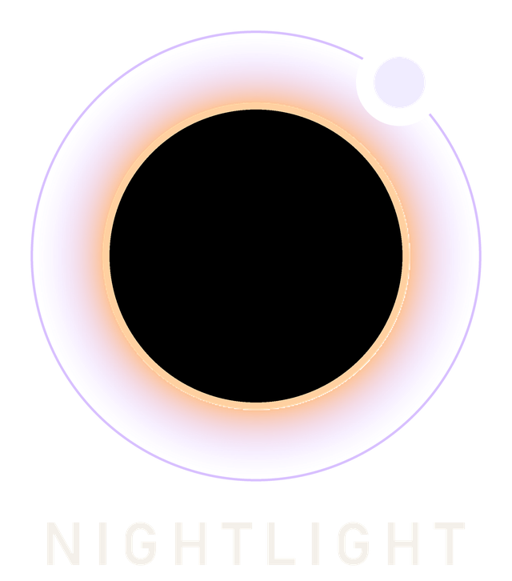
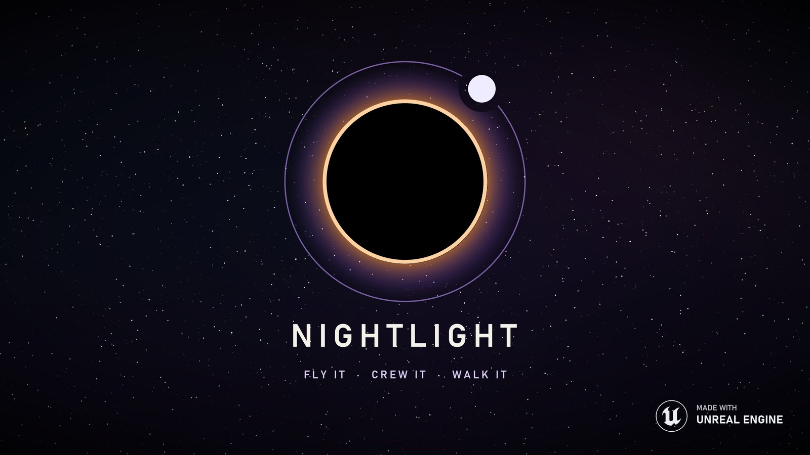
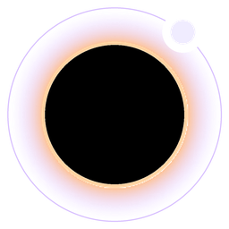

  

<b>FLY IT &nbsp;·&nbsp; CREW IT &nbsp;·&nbsp; WALK IT</b>

An online multiplayer top-down space game: Newtonian flight, ships you can walk around inside, a station to dock at,
jobs to take, pirates to fight. This repository holds the **downloadable game** only.

**Early test build.** Expect rough edges.

## Download and install (Windows)

1. Download **Nightlight-Setup.exe** from the [latest release](https://github.com/RobSpada/Nightlight-Unreal-Releases/releases/latest)
   and run it. Choose where to install it (your own programs folder by default; no administrator rights needed).
2. Start **Nightlight**. The launcher downloads the game the first time (about 1.1 GB), then **PLAY**.

**Updates are automatic.** The launcher checks for a new version when it opens, and every five minutes while it's
open, and downloads only the parts of the game that changed, never the whole game again. **REPAIR** re-checks every
file if something goes wrong.

To remove it: *Settings > Apps > Nightlight > Uninstall*. The uninstaller removes everything the game put on your PC.

**You need:** Windows 10 or 11 (64-bit), a DirectX 12 graphics card (an NVIDIA RTX card is recommended: the game uses
Lumen lighting and DLSS), about 8 GB of free disk space.

## Playing

- **PLAY ONLINE**: one shared universe. Everyone who plays online is in it together; you see the other pilots' ships
  and their names. Your progress is saved online.
- **PLAY OFFLINE**: fly on your own. Your progress is saved on your PC.
- **OPTIONS** (also **Esc** / **F10** in the game): resolution, detail, DLSS, key bindings, sound.

---

   
  Made with Unreal Engine

